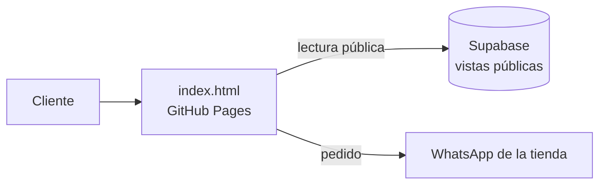

# 🛍️ Valkat Store · Catálogo público

Página web pública de **Valkat Store** (Importaciones Adrielito E.I.R.L.) donde los clientes miran el catálogo de cámaras de seguridad, accesorios y memorias, arman su pedido y lo **confirman por WhatsApp**.

Es una sola página (`index.html`), sin pasos de compilación ni dependencias: se publica tal cual en GitHub Pages.

🔗 **Página:** https://juliodipazdelacruz-stack.github.io/valkat-catalogo/

> Este repositorio es la parte pública de cara al cliente. Los productos, precios e imágenes se administran en el sistema POS de Valkat Store y salen de la misma base de Supabase.

---

## ✨ Qué puede hacer el cliente

| Función | Detalle |
|---|---|
| Ver el catálogo | Productos agrupados por categoría, con foto, marca y precio. |
| Buscar | Por nombre o marca, con filtrado al escribir. |
| Ver el detalle | Galería de imágenes, video del producto, características destacadas y descuento visible (precio anterior tachado y porcentaje). |
| Armar el pedido | Barra flotante con el total y panel con las cantidades de cada producto. |
| Memorias | Promoción de memoria para cada cámara: de regalo o con descuento, con opciones de más capacidad a precio especial. |
| Resumen del pedido | Genera una imagen con el detalle y el total, que se puede copiar o descargar. |
| Confirmar por WhatsApp | Abre un chat con el resumen del pedido ya escrito. |
| Compartir con imagen | En celulares que lo permiten, abre el menú de compartir con la imagen del resumen y el texto ya cargados; el cliente elige WhatsApp y el chat de la tienda. El botón solo aparece si el navegador soporta compartir archivos. |
| Transmisión en vivo | Aviso con enlace a la transmisión de TikTok, que se activa o desactiva desde la base de datos. |

Está pensada para celular, que es desde donde entran la mayoría de los clientes.

> **El pedido no se guarda en ningún sistema.** El cliente lo envía por WhatsApp y la venta se registra después en el POS.
>
> Los enlaces de WhatsApp solo pueden llevar texto, no imágenes. Por eso hay dos formas de enviar el pedido: **Enviar por WhatsApp** abre directamente el chat de la tienda con el pedido escrito (siempre llega al número correcto), y **Compartir con imagen** adjunta también la imagen, pero el cliente debe elegir el chat.

---

## 🧱 Cómo funciona



La página consulta tres **vistas de solo lectura** de Supabase mediante la API REST, usando la clave pública (`publishable`). Si la conexión falla, muestra un catálogo de ejemplo para no quedar en blanco.

### Vistas de Supabase que lee la página

| Vista | Columnas que usa |
|---|---|
| `catalogo_publico` | `id`, `nombre`, `marca`, `tipo`, `precio`, `precio_anterior`, `imagen_url`, `video_url`, `galeria` (lista de URL), `destacados` (lista de textos), `es_camara`, `disponible` |
| `promo_memorias_publica` | `activa`, `titulo`, `texto`, `regalo_activo`, `regalo_disponible`, `regalo_modo` (`gratis` o `descuento`), `regalo_nombre`, `regalo_marca`, `regalo_capacidad`, `regalo_normal`, `regalo_especial`, `opciones` (lista de objetos con `id`, `nombre`, `marca`, `capacidad`, `normal`, `especial`) |
| `live_publico` | `activo`, `url`, `titulo` |

Detalles de lectura:
- El catálogo se ordena con las cámaras primero y luego por nombre.
- Las categorías se arman solas a partir del campo `tipo` de los productos.
- Los productos con `disponible = false` no se muestran.
- Las vistas deben exponer **solo datos públicos**: nada de costos ni de cantidades exactas de stock.

---

## ⚙️ Configuración

Todo se configura al inicio del `<script>` de `index.html`:

| Valor | Dónde | Para qué |
|---|---|---|
| `CONFIG.whatsapp` | Línea de datos iniciales | Número que recibe los pedidos, con código de país y sin signos (por ejemplo `51912345678`). |
| `CONFIG.live` | Línea de datos iniciales | Valor inicial del aviso de transmisión; la base de datos lo reemplaza. |
| `SB.url` y `SB.key` | Bloque "Conexión con Supabase" | URL del proyecto y clave pública. |

> 🔑 `SB.key` es una clave **publishable**: está diseñada para estar visible en páginas públicas, y la seguridad real la ponen las políticas de la base de datos. **Nunca** pongas aquí una clave `service_role` ni `sb_secret_…`.

---

## 🚀 Publicar en GitHub Pages

1. Sube al repositorio los archivos de la raíz: `index.html`, `og-image.png` y este `README.md`. El archivo debe llamarse **`index.html` en minúscula**, porque GitHub Pages distingue mayúsculas.
2. En el repositorio entra a **Settings → Pages**.
3. En **Build and deployment**, elige **Deploy from a branch**, rama `main` y carpeta `/ (root)`.
4. En uno o dos minutos la página estará disponible en la dirección de arriba.

Con una cuenta gratuita de GitHub, el repositorio debe ser público para usar Pages.

## 🧪 Probar en tu computadora

Abre `index.html` con doble clic, o levanta un servidor local:

```bash
python -m http.server 8000
```

y entra a `http://localhost:8000`. Para confirmar que los datos reales están cargando, abre las herramientas del navegador (F12 → Console): si aparece el aviso **"Sin conexión a Supabase, se usan datos de ejemplo"**, la página está mostrando el catálogo de ejemplo y no el real.

---

## 🔗 Vista previa al compartir el enlace

Cuando se comparte la dirección en WhatsApp, Facebook u otras redes, aparece una tarjeta con la imagen `og-image.png` (1200 × 630 px), el título y una descripción. Esos datos están en las etiquetas `og:` y `twitter:` del `<head>` de `index.html`.

- Si cambias el nombre del repositorio o usas un dominio propio, actualiza `og:url`, `og:image` y `twitter:image`.
- WhatsApp guarda en memoria la vista previa de cada enlace. Si cambias la imagen o el texto y no se actualiza, comparte el enlace con un parámetro nuevo, por ejemplo `.../valkat-catalogo/?v=2`.

---

## 📁 Estructura

```
.
├── index.html      # La página completa (estilos, código y logo incluidos)
├── og-image.png    # Imagen de la vista previa al compartir el enlace
└── README.md
```

---

## 👤 Autor

Desarrollado por [@juliodipazdelacruz-stack](https://github.com/juliodipazdelacruz-stack) para Valkat Store.
